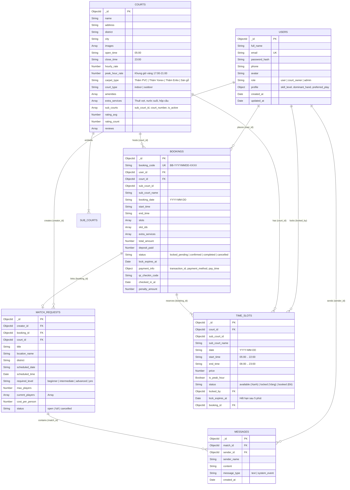

# SƠ ĐỒ THIẾT KẾ CƠ SỞ DỮ LIỆU MONGODB (ERD) - Badminton Booking

## 1. Sơ đồ quan hệ thực thể (Entity-Relationship Diagram)



---

## 2. Giải thích kỹ thuật xử lý Concurrency (Atomic Slot Locking)

- **Unique Compound Index trên `TimeSlots`**: `{ court_id: 1, sub_court_id: 1, date: 1, start_time: 1 }` đảm bảo không bao giờ sinh trùng 2 bản ghi cho cùng 1 khung giờ của 1 sân con.
- **Câu lệnh Atomic Update chống Race Condition**:
  ```javascript
  const lockedSlot = await TimeSlot.findOneAndUpdate(
    { _id: slotId, status: 'available' },
    {
      $set: {
        status: 'locked',
        locked_by: userId,
        lock_expires_at: new Date(Date.now() + 5 * 60 * 1000)
      }
    },
    { new: true }
  );
  ```
- Nếu 2 người chơi cùng bấm đặt 1 khung giờ ở cùng 1 mili-giây, MongoDB đảm bảo tính nguyên tử (Atomicity) ở mức document: chỉ 1 request nhận được `lockedSlot`, request còn lại nhận `null` và trả về ngay thông báo: **"Khung giờ này vừa có người nhanh tay chọn trước!"**.

